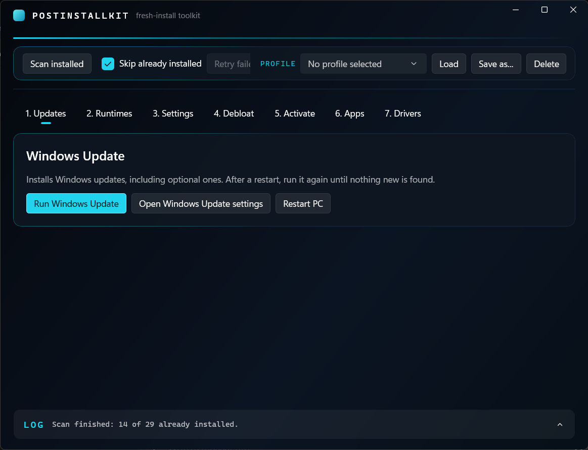

# PostInstallKit



**A clean, dark WinUI toolkit that sets up a fresh Windows install in a few clicks.**


---

## About

**PostInstallKit** is a Windows app that automates the steps you repeat after every Windows install or reinstall: updates, runtimes, system tweaks, debloating, apps, and driver downloads.

Instead of clicking through the same installers every time, you go through seven tabs, tick what you want, and let the app do the work.

PostInstallKit is made for people who reinstall Windows often and want a faster, cleaner routine.

---

## Features

- Seven tabs that follow a fresh-install routine, from updates to drivers
- Installs **.NET Desktop Runtimes**, **Visual C++ Redistributables**, **Java (Eclipse Temurin JDKs)** and **DirectX** through winget
- Common apps checklist (browsers, 7-Zip, VLC, Notepad++, VS Code, Discord, Steam)
- Detects what is already installed and can skip it
- Retry button for installs that failed
- Saved profiles, so your favorite selection is one click away
- Runs Windows Update, including optional updates, with a restart button
- Windows settings: power plan, no sleep when plugged in, file extensions, hidden files, This PC icon, .NET Framework 3.5
- Launches the [Chris Titus Tech WinUtil](https://github.com/ChrisTitusTech/winutil) for debloating, optionally with your own saved config
- Launcher for your own scripts or tools in `Tools\Activation` (nothing is included)
- Driver tab with quick links to the official driver pages of the big brands
- Dark WinUI interface with a collapsible log
- Portable: self-contained, no installer, runs from a USB stick

---

## The 7 Steps

| Tab | What it does |
|-----|--------------|
| 1. Updates | Runs Windows Update (including optional updates) and restarts the PC |
| 2. Runtimes | Installs .NET, Visual C++ Redistributables, Java and DirectX |
| 3. Settings | Applies the Windows settings you tick |
| 4. Debloat | Launches the Chris Titus Tech tool, with or without your config |
| 5. Activate | Launches your own `.cmd`, `.bat` or `.exe` from `Tools\Activation` |
| 6. Apps | Installs your common apps |
| 7. Drivers | Opens the driver download page of your brand |

---

## What Gets Installed

| Category | Included |
|----------|----------|
| .NET | Desktop Runtime 6, 8, 9, 10 |
| Visual C++ | Redistributables 2005, 2008, 2010, 2012, 2013, 2015-2022 (x86 and x64) |
| Java | Eclipse Temurin JDK 8, 17, 21, 25 |
| Runtime | DirectX End-User Runtime |
| Apps | Chrome, Firefox, 7-Zip, VLC, Notepad++, VS Code, Discord, Steam |

The list lives in `AppCatalog.cs`, so adding or removing an app is one line.

---

## Requirements

- Windows 10 (version 1809 or newer) or Windows 11, 64-bit
- Internet connection
- Administrator rights (the app asks for them when it starts)
- [winget](https://learn.microsoft.com/windows/package-manager/winget/) (the "App Installer"; included in Windows 11)
- .NET 8 and Visual Studio 2022 only if building from source

The published build is self-contained, so no .NET or Windows App SDK needs to be installed.

On a very bare Windows install, you may need the Microsoft Visual C++ runtime first. Windows SmartScreen may also warn about the app, because it is not code-signed.

---

## How To Use

1. Download the latest release and unzip it.
2. Run `PostInstallKit.exe` and accept the administrator prompt.
3. Go through the tabs from left to right.
4. Tick what you want and press the install or apply button on each tab.
5. Watch the log at the bottom (click it to expand).

Saved profiles, your activation script and your Chris Titus config live in the app folder, so you can carry everything on a USB stick.

---

## Your Own Tools

PostInstallKit includes no activation tool. If you have your own script or tool, put it in:

```
Tools\Activation\
```

and it appears on the **Activate** tab. To use your own Chris Titus config, export it from the tool (gear icon, Export) and save it as:

```
Tools\Titus\config.json
```

---

## Building From Source

1. Install Visual Studio 2022 with the **Windows application development** workload.
2. Clone this repository:

```
git clone https://github.com/cyntx1069/PostInstallKit.git
```

3. Open `PostInstallKit.sln` in Visual Studio.
4. Set the platform to **x64** and press **F5** (start Visual Studio as administrator).

To make a portable build:

```
dotnet publish -c Release -p:Platform=x64 -p:PublishProfile=win-x64
```

---

## Project Status

PostInstallKit is currently at **version 1.0**.

The runtime and app installs, profiles, settings, and the debloat launcher are working. The Windows Update step and the automatic run of a saved Chris Titus config are newer and still being tested.

Planned future ideas:

- Editable app list inside the app
- Resume Windows Update automatically after restarts
- More apps and presets
- Custom app themes

---

## Credits

Made by **Cynt X**.

[](https://discord.com)

PostInstallKit does not include or redistribute third-party tools. The Chris Titus Tech tool is downloaded from its official source when you launch it, and apps are installed through winget.  
PostInstallKit is not affiliated with Microsoft, Chris Titus Tech, Eclipse Adoptium, or any of the app and driver vendors it links to.
